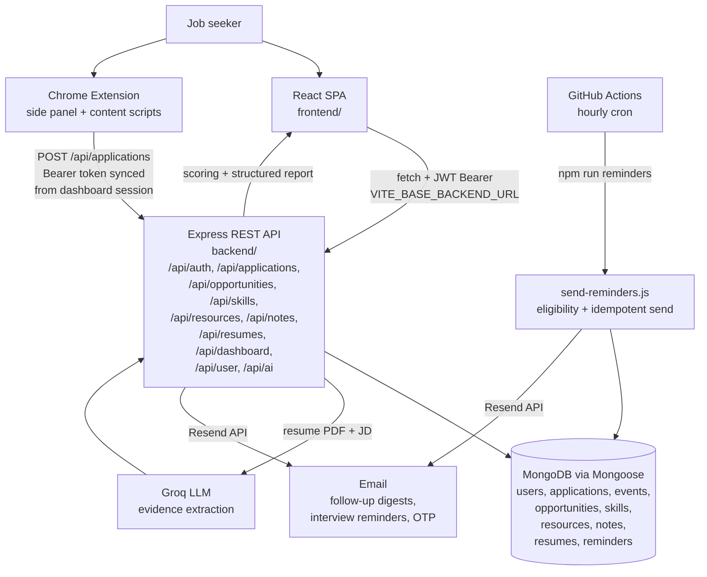

# TrackMyHunt

> **Your job hunt, organized.**

TrackMyHunt is a full-stack job-hunt management platform for students, job seekers, and developers managing multiple applications. Instead of juggling job boards, spreadsheets, resume files, notes, and calendars, you run the whole search from one workspace: track applications on a Kanban board, plan future opportunities, manage resume links, analyze your resume against job descriptions with AI, and get email reminders for follow-ups and interviews. A companion Chrome extension captures job postings from supported portals and saves them straight to your dashboard.

- **Live demo:** [https://trackmyhunt.vercel.app](https://trackmyhunt.vercel.app) (verified live)
- **Repository:** [https://github.com/ayushkhandelwal18/trackmyhunt-ai](https://github.com/ayushkhandelwal18/trackmyhunt-ai)
- **Chrome extension repo:** [https://github.com/ayushkhandelwal18/trackmyhunt-chrome-extension](https://github.com/ayushkhandelwal18/trackmyhunt-chrome-extension) (verified; extension source also lives in [`extension/`](#project-structure))

---

## Table of Contents

- [Project Overview](#project-overview)
- [Features](#features)
  - [Dashboard and Application Overview](#dashboard-and-application-overview)
  - [Application Tracker and Kanban Board](#application-tracker-and-kanban-board)
  - [Application Stages and Status History](#application-stages-and-status-history)
  - [Chrome Extension](#chrome-extension)
  - [Resume Manager](#resume-manager)
  - [AI Resume and Job Description Analyzer](#ai-resume-and-job-description-analyzer)
  - [Email Reminders](#email-reminders)
  - [Opportunity Planner](#opportunity-planner)
  - [Skillboard](#skillboard)
  - [Resources Hub](#resources-hub)
  - [Notes and Brain Dump](#notes-and-brain-dump)
  - [Authentication and Profile Management](#authentication-and-profile-management)
- [Screenshots and Demo](#screenshots-and-demo)
- [Technology Stack and Libraries](#technology-stack-and-libraries)
  - [Frontend](#frontend)
  - [Backend](#backend)
  - [AI, Email, and File Processing](#ai-email-and-file-processing)
  - [Chrome Extension](#chrome-extension-1)
  - [Testing, Linting, and Tooling](#testing-linting-and-tooling)
- [Architecture](#architecture)
- [Getting Started](#getting-started)
  - [Prerequisites](#prerequisites)
  - [Clone the Repository](#clone-the-repository)
  - [Backend Setup](#backend-setup)
  - [Frontend Setup](#frontend-setup)
  - [Run the Application](#run-the-application)
  - [Reminder Worker](#reminder-worker)
  - [Chrome Extension Setup](#chrome-extension-setup)
- [Environment Variables](#environment-variables)
  - [Backend (`backend/.env`)](#backend-backendenv)
  - [Frontend (`frontend/.env`)](#frontend-frontendenv)
  - [Extension (`extension/.env`)](#extension-extensionenv)
- [Usage Guide](#usage-guide)
- [Testing and Code Quality](#testing-and-code-quality)
- [Security and Privacy](#security-and-privacy)
- [Project Structure](#project-structure)
- [Deployment](#deployment)
- [Contributing](#contributing)
- [License and Project Status](#license-and-project-status)

---

## Project Overview

Job hunting usually means switching between job boards, spreadsheets, resume versions, prep notes, and calendar reminders. TrackMyHunt brings those workflows into a single account-backed workspace backed by a Node.js/Express REST API and MongoDB.

**Who it is for:** students, job seekers, and developers running parallel applications across portals.

**What it does, in one flow:** discover a role → capture it with the extension (or add it manually) → organize it on a Kanban pipeline → attach the resume link you applied with → analyze your resume against the job description → get reminded to follow up → keep preparing with skills, resources, and notes.

---

## Features

### Dashboard and Application Overview

The dashboard (`frontend/src/pages/Dashboard.jsx`, `GET /api/dashboard`) summarizes the hunt: application statistics and progress, upcoming interviews and scheduled reminders, recent application activity, and shortcuts into the rest of the workspace.

### Application Tracker and Kanban Board

- Add applications manually or capture them with the Chrome extension.
- Organize them on a **drag-and-drop Kanban board** (`frontend/src/components/applications/KanbanBoard.jsx`); dropping a card updates its status via the API.
- Store company, role, type, applied date, skills, application link, notes, and per-status details (interview / online-assessment / rejection info).
- **Duplicate detection:** the backend blocks creating the same application twice (normalized URL or company + role match) and the extension surfaces the duplicate state instead of re-saving.

### Application Stages and Status History

Applications move through the statuses defined in `backend/models/application.models.js`:

```text
Applied → Resume Shortlisted → OA Done → Interview Scheduled → Interview Done → Rejected
(plus "Other" for anything outside the standard pipeline)
```

Every status change is recorded on a per-application timeline (`application-event.model.js`), visible on the application detail page (`/applications/:id`).

### Chrome Extension

The companion extension (`extension/`, Manifest V3 + Side Panel API) extracts company, role, location, type, description, and canonical URL from supported pages, lets you review and edit everything in the side panel, optionally maps one of your saved resumes, and saves via `POST /api/applications` using your dashboard session — no separate extension login.

Supported sources (see `extension/README.md` and `extension/src/content/scrapers/`): **LinkedIn, Indeed, Naukri, Internshala, Greenhouse, Lever, Workday, Ashby, Wellfound, Google Forms, company career pages, and generic job pages.** Extraction quality varies by page structure; missing fields are left blank, never invented.

### Resume Manager

TrackMyHunt stores **resume links, not resume files**: each entry is a title, URL, and optional description. You can keep multiple versions (e.g. backend / frontend / general), link the exact resume used to each application (`resumeId`, ownership-checked server-side), and copy the link while filling out application forms.

### AI Resume and Job Description Analyzer

Upload a resume PDF (max 5 MB, PDF-only, held in memory for the request — never written to disk or stored) and paste a job description to receive a structured report (`POST /api/ai/analyze`):

- Overall **Resume Match Score** with fit level and summary
- Weighted **match breakdown** (skills/technical, experience, responsibilities, education)
- **Matched skills** vs **missing must-have skills**
- **Good-to-have skills and improvements**
- **Final recommendation**

Scoring is computed server-side (`backend/services/ai.service.js`); the Groq-hosted model provides evidence extraction, and the analysis is explanatory — it does not predict hiring outcomes.

### Email Reminders

Configurable from Profile → Email reminders (`PUT /api/user/reminders`):

- Master on/off switch for all reminder emails
- **Application follow-ups**: one digest email when enough applications have waited past the follow-up window (configurable "follow up after" days and minimum pending-application count)
- **Interview reminders**: one consolidated email for interviews entering the reminder window (configurable hours-before)
- A background worker (`npm run reminders` → `backend/scripts/send-reminders.js`) evaluates eligibility each run and can be scheduled hourly via the included GitHub Actions workflow (`.github/workflows/reminders.yml`)

Powered by **Resend** (OTP, welcome, follow-up, and interview templates in `backend/templates/`).

### Opportunity Planner

A wishlist for roles you have not applied to yet: company/event name, role, type, expected opening month and year, required skills, application link, and notes — with edit and delete actions. Kept separate from active applications.

### Skillboard

Track skills with proficiency (`Beginner` / `Intermediate` / `Advanced` / `Expert`, per `backend/models/skill.model.js`), category, and target role; attach notes and resources to individual skills to track learning progress alongside job preparation.

### Resources Hub

Save and organize prep links — repositories, documentation, dev tools, videos, spreadsheets, posts, and guides — in one searchable place.

### Notes and Brain Dump

Free-form notes for interview takeaways, preparation checklists, ideas, lists, and reminders — the lightweight scratchpad for everything that does not belong elsewhere.

### Authentication and Profile Management

- Email + password signup with **OTP email verification**, login, resend-OTP, and forgot/reset-password flows (`/api/auth/*`)
- **Google OAuth** sign-in (`POST /api/auth/google`)
- JWT Bearer authentication on protected routes; Google-only accounts can set a local password later
- Profile editing, password change, reminder preferences, light/dark theme toggle, and account deletion (password + typed confirmation)

---

## Screenshots and Demo

> **Screenshot placeholders** — no screenshots are currently checked into the repository (the only image assets are `frontend/src/assets/*.png` used by the landing page and favicons in `frontend/public/` and `extension/public/`). To add screenshots, save them under a new `docs/screenshots/` folder and replace the placeholders below with repository-relative paths, e.g. ``.

- [ ] Landing page / hero
- [ ] Dashboard overview
- [ ] Application Kanban board
- [ ] AI Analyzer report
- [ ] Chrome extension side panel

Live demo (verified): [https://trackmyhunt.vercel.app](https://trackmyhunt.vercel.app)

---

## Technology Stack and Libraries

Every item below was verified against `package.json` manifests, imports, and implementation. Transitive dependencies are not listed.

### Frontend

| Technology | Purpose in TrackMyHunt |
|---|---|
| React 19 + React DOM (`react`, `react-dom`) | UI for all pages and components |
| Vite 7 (`vite`, `@vitejs/plugin-react`) | Dev server and production build (`npm run dev`, `npm run build`, `npm run preview`) |
| Tailwind CSS 4 (`tailwindcss`, `@tailwindcss/vite`) | Utility-first styling |
| React Router 7 (`react-router-dom`) | Public routes (`/`, `/auth`), protected app routes, 404 catch-all |
| Google OAuth (`@react-oauth/google`) | Google sign-in button and provider |
| Lucide React (`lucide-react`) | Icon set across the UI |
| ESLint 9 (`eslint`, `@eslint/js`, plugins) | Linting (`npm run lint`) |

The frontend uses `fetch` (no HTTP client library) through a central gateway (`frontend/src/services/api.js`) that attaches the JWT. State is managed with React context (`AuthContext`, `ThemeContext`); there is no global store or chart/notification/form library.

### Backend

| Technology | Purpose in TrackMyHunt |
|---|---|
| Node.js 20 (per CI workflow; 18+ minimum per docs) + Express 5 (`express`) | REST API (`backend/app.js`, `backend/server.js`, `backend/routes/*`) |
| MongoDB + Mongoose 9 (`mongoose`) | Database and ODM (`backend/models/*`: user, application, application-event, opportunity, skill, resource, note, resume, reminder) |
| JSON Web Tokens (`jsonwebtoken`) | Bearer-token sessions (7-day email login; 30-day Google login) |
| Google Auth (`google-auth-library`) | Verifying Google ID tokens server-side |
| bcrypt (`bcrypt`) | Password hashing |
| CORS (`cors`), cookie-parser (`cookie-parser`), dotenv (`dotenv`) | Middleware and env loading |
| validator (`validator`) | Input validation helpers (e.g. user model) |
| nodemon (`nodemon`, listed under `dependencies`) | Local auto-reload via `npm run dev` |

### AI, Email, and File Processing

| Technology | Purpose in TrackMyHunt |
|---|---|
| Groq SDK (`groq-sdk`) | Server-side LLM evidence extraction for the resume/JD analyzer (API key stays in the backend) |
| Resend (`resend`) | OTP, welcome, follow-up, and interview emails (`backend/services/mail.services.js`, `backend/templates/*.html`) |
| multer (`multer`) | In-memory-only PDF upload handling (5 MB cap, PDF-only filter) |
| pdf-parse (`pdf-parse`) | Resume PDF text extraction |
| mammoth (`mammoth`) | DOCX text extraction path in the resume-extract service |

### Chrome Extension

| Technology | Purpose in TrackMyHunt |
|---|---|
| React 19 + Vite 8 (`react`, `react-dom`, `vite`, `@vitejs/plugin-react`) | Side-panel UI and build |
| Tailwind CSS 3 + PostCSS (`tailwindcss`, `postcss`, `autoprefixer`) | Extension styling (separate v3 chain from the frontend's v4 setup) |
| CRXJS Vite plugin (`@crxjs/vite-plugin`) | Manifest V3 packaging (`npm run build` → `extension/dist/`) |
| Chrome Manifest V3 APIs | `sidePanel` (toolbar-click opens the panel), `storage`, `scripting`, `tabs`, `activeTab`; content scripts for extraction + dashboard session sync |
| oxlint (`oxlint`) | Linting (`npm run lint`) |
| Node test runner (`node --test`) | Offline extractor tests (`extension/test/*.mjs` with `test/fakeDom.mjs` fixtures) |

### Testing, Linting, and Tooling

| Tool | Scope | Command |
|---|---|---|
| Node built-in test runner | Backend `backend/tests/*.test.js` (reminders, AI scoring/validation, upload handling, resume extraction, email templates) | `npm test` (in `backend/`) |
| Node built-in test runner | Extension extractor tests | `npm test` (in `extension/`) |
| ESLint | Frontend | `npm run lint` (in `frontend/`) |
| oxlint | Extension | `npm run lint` (in `extension/`) |
| GitHub Actions | Hourly reminder cycle (`.github/workflows/reminders.yml`) | Runs `npm run reminders` on schedule |

The frontend has no test script or test framework. The backend has no linter configured.

---

## Architecture



Request flow details:

- **Authentication:** email/password with OTP verification, or Google ID token verified server-side; subsequent calls carry `Authorization: Bearer <JWT>`. The extension reuses the dashboard JWT (synced content-script → `chrome.storage.local`) and never asks for a password.
- **AI analysis:** `multipart/form-data` (`resumePdf` + `jobDescription`) → multer memory upload → text extraction → Groq evidence extraction → server-side scoring/validation → JSON report. Saved resume links are never read by the analyzer.
- **Reminders:** user preferences live on the user document; the worker claims due reminders with idempotency markers, so overlapping runs cannot double-send.
- **Extension saves:** side panel scrapes (JSON-LD → portal extractor → meta → DOM fallback), user reviews, background worker POSTs the application payload (including optional ownership-checked `resumeId`), and the backend rejects duplicates.

---

## Getting Started

### Prerequisites

- **Node.js 18+** (CI uses Node 20), **npm 9+**
- **MongoDB** connection string (local or MongoDB Atlas)
- **Google Chrome 116+** (extension only)
- Optional service accounts: **Groq** API key (AI Analyzer), **Resend** account + verified sender (emails), **Google OAuth** client ID (Google sign-in)

### Clone the Repository

```bash
git clone https://github.com/ayushkhandelwal18/trackmyhunt-ai.git
cd trackmyhunt-ai
```

### Backend Setup

```bash
cd backend
npm install
```

Create `backend/.env` (see [Environment Variables](#backend-backendenv)):

```text
backend/.env
```

Start the API (verified script: `dev` → `nodemon server.js`):

```bash
npm run dev
```

Default URL (see `backend/server.js`; default port is `5000` unless `PORT` is set):

```text
http://localhost:5000
```

> The existing README's examples use port `3000`; the code default is `5000`. Set `PORT=3000` in `backend/.env` if you follow the `3000`-based examples below.

Production start (verified script):

```bash
npm start
```

### Frontend Setup

```bash
cd frontend
npm install
```

Create `frontend/.env` (see [Environment Variables](#frontend-frontendenv)):

```text
frontend/.env
```

```env
VITE_GOOGLE_CLIENT_ID=your_google_client_id
VITE_BASE_BACKEND_URL=http://localhost:3000
```

Start the app (verified scripts):

```bash
npm run dev      # dev server → http://localhost:5173
npm run build    # production build
npm run preview  # preview the production build
npm run lint     # eslint (currently reports 1 unused-import error in AiAnalyzer.jsx)
```

### Run the Application

Run backend and frontend in two terminals, then open `http://localhost:5173`. The landing page is public; `/dashboard` and all workspace routes require sign-in.

### Reminder Worker

Run one reminder cycle manually (verified script → `node scripts/send-reminders.js`):

```bash
cd backend
npm run reminders
```

In production this is scheduled hourly by `.github/workflows/reminders.yml` (cron `30 * * * *` plus manual dispatch), which needs `DATABASE_URL`, `RESEND_API_KEY`, `RESEND_FROM_EMAIL`, `RESEND_FROM_NAME`, and `CLIENT_URL` as repository secrets/variables.

### Chrome Extension Setup

The extension has its own documented setup in [`extension/README.md`](extension/README.md) (reference only — do not edit that file). In short, from the `extension/` directory:

```bash
npm install
npm run build   # emits extension/dist/
npm test        # offline extractor tests
npm run lint    # oxlint
```

Then load it in Chrome: open `chrome://extensions/` → enable **Developer mode** → **Load unpacked** → select `extension/dist/`. Create `extension/.env` before building; see `extension/README.md` for the exact variables (rebuild after changing them). Clicking the toolbar icon opens the TrackMyHunt side panel on the current tab.

---

## Environment Variables

Only the variable **names** already present in the existing root README are documented below (verified against source usage). Values shown are safe placeholders — never commit real secrets.

### Backend (`backend/.env`)

| Variable | Purpose | Verified usage |
|---|---|---|
| `CLIENT_URL` | Public frontend origin (CORS allowlist, email links) | `backend/app.js`, reminder service |
| `DATABASE_URL` | MongoDB connection string | `backend/config/database.js` |
| `JWT_SECRET` | Signs auth tokens | Auth service, auth middleware, Google login |
| `GOOGLE_CLIENT_ID` | Verifies Google ID tokens | `backend/controllers/auth.controller.js` |
| `PORT` | API listen port (code default `5000`) | `backend/server.js` |
| `RESEND_API_KEY` | Resend API key for all outgoing mail | `backend/services/mail.services.js` |
| `RESEND_FROM_EMAIL` | Verified sender address | `backend/services/mail.services.js` |
| `RESEND_FROM_NAME` | Sender display name | `backend/services/mail.services.js` |
| `groq_api_key` | Groq key for the AI Analyzer (backend only) | AI service |
| `EMAIL_FROM` | ⚠️ Needs verification — no usage found in backend source | Not referenced in code |
| `EMAIL_PASS` | ⚠️ Needs verification — no usage found in backend source | Not referenced in code |
| `EMAIL_USER` | ⚠️ Needs verification — no usage found in backend source | Not referenced in code |
| `EMAIL_PROVIDER` | ⚠️ Needs verification — no usage found in backend source | Not referenced in code |

> `EMAIL_FROM`, `EMAIL_PASS`, `EMAIL_USER`, and `EMAIL_PROVIDER` appear in the previous version of this README but have **no matches in the backend source** (mail goes through Resend). They are kept here for continuity pending verification — do not rely on them.

### Frontend (`frontend/.env`)

| Variable | Purpose | Verified usage |
|---|---|---|
| `VITE_BASE_BACKEND_URL` | Backend origin (API base + cold-start wake-up ping) | `frontend/src/services/api.js` |
| `VITE_GOOGLE_CLIENT_ID` | Google OAuth client ID for the sign-in button | `frontend/src/main.jsx` |

### Extension (`extension/.env`)

The extension's exact `.env` variables are documented in [`extension/README.md`](extension/README.md) (which also notes that no API keys or secrets belong in the extension `.env`). Per the scope of this rewrite no new variable names are introduced here — follow that file when configuring `extension/.env` before `npm run build`.

---

## Usage Guide

1. **Create an account or sign in** at `/auth` with email + OTP verification or Google.
2. **Save resume links** on the Resumes page (title + URL + optional description) — links, not files.
3. **Add applications** manually on the Applications page, or open a supported job posting and capture it with the extension (review fields, optionally pick a saved resume, Save to TrackMyHunt).
4. **Work the pipeline**: drag cards across Kanban stages, open `/applications/:id` for the timeline and per-status details.
5. **Map resumes** to applications so you always know which version you sent.
6. **Analyze fit**: on the AI Analyzer page, upload the resume PDF, paste the job description, and review the match report.
7. **Plan ahead** on the Opportunity Planner wishlist (opening month/year, skills, links, notes).
8. **Prepare** with the Skillboard, Resources Hub, and Notes.
9. **Configure reminders** in Profile → Email reminders (master switch, follow-up window + digest threshold, interview lead time).

---

## Testing and Code Quality

| Check | Command | Result (actually executed for this rewrite) |
|---|---|---|
| Backend tests | `npm test` in `backend/` (Node test runner, 5 suites: reminders, email templates, resume extraction, AI analyzer, AI upload) | ✅ **96/96 pass** |
| Extension tests | `npm test` in `extension/` (LinkedIn + Wellfound extractor fixtures) | ✅ **32/32 pass** |
| Frontend lint | `npm run lint` in `frontend/` (ESLint) | ❌ **1 error**: `src/pages/AiAnalyzer.jsx:77` — `'Icon' is defined but never used` |
| Frontend build | `npm run build` in `frontend/` (Vite) | ✅ **Passes** (1,756 modules) |
| Extension lint | `npx oxlint` in `extension/` | ✅ **Exit 0, clean** |

Not run: extension `vite build` output review, any end-to-end or browser testing (no E2E harness exists in the repo), and the frontend has no test script. Test counts above are from real runs, not documentation claims. No complete-coverage claim is made.

---

## Security and Privacy

Only practices confirmed in the implementation are listed:

- Passwords are hashed with **bcrypt** before storage (`backend/services/auth.service.js`).
- Protected API routes require a **JWT Bearer token** (`backend/middleware/auth.middleware.js`); Google sign-ins verify the ID token server-side with `google-auth-library`.
- **Google OAuth** is supported alongside email/OTP auth; OTP and reset flows are email-based via Resend.
- Resume PDFs sent to the AI Analyzer are held **in memory for the single request** (multer `memoryStorage`, 5 MB cap, PDF-only filter) — never written to disk or stored (`backend/routes/ai.routes.js`).
- The Resume Manager stores **links**, and the analyzer never reads saved resumes (every analysis carries its own upload).
- API keys, JWT secrets, and the database URL live in **environment variables**, never in source (see [Environment Variables](#environment-variables)).
- The Chrome extension reuses the dashboard JWT from the user's own session; users never type a password into the extension.

Limitations worth knowing: JWTs are long-lived and stored in browser `localStorage` (standard SPA tradeoff — XSS would expose the session); email delivery and AI inference depend on third-party services (Resend, Groq); there is no end-to-end encryption, and administrators with database access can read stored data. No production-readiness claim is made here.

---

## Project Structure

```text
TrackMyHunt/
├── README.md                    # This file (root documentation)
├── .github/workflows/
│   └── reminders.yml            # Hourly reminder-cycle scheduler
├── backend/                     # Express REST API (CommonJS)
│   ├── app.js / server.js        # App wiring, route mounts, listen
│   ├── config/                  # Database connection
│   ├── controllers/             # Request handlers (auth, user, AI, resources…)
│   ├── middleware/              # JWT auth guard
│   ├── models/                  # Mongoose schemas (user, application,
│   │                            #   application-event, opportunity, skill,
│   │                            #   resource, note, resume, reminder)
│   ├── routes/                  # /api/auth, /api/user, /api/applications,
│   │                            #   /api/opportunities, /api/skills,
│   │                            #   /api/resources, /api/notes,
│   │                            #   /api/dashboard, /api/resumes, /api/ai
│   ├── services/                # Auth, AI analysis, reminders, mail, extraction
│   ├── templates/               # OTP, welcome, follow-up, interview emails
│   ├── scripts/                 # send-reminders.js (npm run reminders)
│   ├── utils/                   # Reminder helpers and shared logic
│   ├── tests/                   # node:test suites (npm test)
│   └── package.json             # start / dev / reminders / test
├── frontend/                    # React 19 + Vite + Tailwind v4 SPA
│   ├── vercel.json              # SPA rewrite (all routes → index.html)
│   ├── index.html
│   └── src/
│       ├── pages/               # Landing, Auth, Dashboard, Applications,
│       │                        #   ApplicationDetail, Opportunities,
│       │                        #   Skillboard, Resources, Notes, Resumes,
│       │                        #   AiAnalyzer, Profile, NotFound
│       ├── components/          # layout, landing, applications, auth,
│       │                        #   opportunities, skills, resources, notes
│       ├── context/             # AuthContext, ThemeContext
│       ├── services/            # api.js — central backend gateway
│       ├── config/ / hooks/ / utils/ / assets/
│       └── App.jsx / main.jsx / index.css
└── extension/                   # Chrome MV3 extension (see extension/README.md)
    ├── manifest.json            # MV3 manifest, side panel, content scripts
    ├── vite.config.js           # CRXJS packaging → extension/dist/
    ├── index.html
    ├── public/                  # Static assets (favicon)
    ├── src/
    │   ├── background/          # Service worker (save API, token, cache)
    │   ├── content/             # extract/ pipeline + scrapers/ per portal
    │   ├── shared/              # Token sync, fallback extractor
    │   ├── App.jsx              # Side-panel UI
    │   └── main.jsx / index.css
    └── test/                    # Offline extractor fixtures (npm test)
```

> `extension/README.md` is the extension's own documentation (plus its setup/usage reference). There is exactly **one** README inside `extension/`; it was used as reference and left untouched — only this root file was rewritten.

---

## Deployment

Only repository-verified facts are stated; hosting choices beyond that are externally configured:

- **Frontend:** `frontend/vercel.json` contains an SPA rewrite (`/(.*)` → `/index.html`), which is the standard Vercel static-deploy setup. The live demo at `trackmyhunt.vercel.app` resolves (verified).
- **Reminders:** `.github/workflows/reminders.yml` runs `npm run reminders` hourly (cron `30 * * * *`, Node 20, skips gracefully without `DATABASE_URL`).
- **Backend/database/email/AI hosting** (e.g. Render, MongoDB Atlas) is **not** configured anywhere in the repository — treat any such mapping as externally configured/unverified. The backend exposes `GET /` as a basic "API is running" check (also used by the frontend's cold-start wake-up ping); there is no dedicated health endpoint.
- Required production secrets/variables: `DATABASE_URL`, `JWT_SECRET`, `RESEND_*`, `groq_api_key`, `GOOGLE_CLIENT_ID`, `CLIENT_URL` (backend) and `VITE_BASE_BACKEND_URL`, `VITE_GOOGLE_CLIENT_ID` (frontend).

---

## Contributing

There is no `CONTRIBUTING` file or license file in the repository, so no formal contribution policy or license terms exist to follow. A reasonable workflow for suggestions and improvements:

1. Fork the repository.
2. Clone your fork:
   ```bash
   git clone https://github.com/YOUR_USERNAME/trackmyhunt-ai.git
   cd trackmyhunt-ai
   ```
3. Create a feature branch:
   ```bash
   git checkout -b feature/your-feature-name
   ```
4. Make focused changes (keep backend, frontend, and extension concerns separate).
5. Run the relevant checks: `npm test` (backend or extension), `npm run lint` (frontend or extension), `npm run build` (frontend or extension).
6. Commit and open a pull request against the original repository.

For larger changes, consider opening an issue first to discuss the approach.

---

## License and Project Status

No license file was found in the repository, so the project's licensing terms are currently unspecified.

TrackMyHunt is an actively developed, working full-stack workspace for organizing the job hunt — applications, opportunities, skills, resumes, AI-assisted resume analysis, reminders, and resources — with a companion Chrome extension for one-click capture. If you find it useful, star the repository and share feedback via issues.

---

*Docs: this root README was rewritten from a full source audit (Dec 2026 generation context: code, manifests, routes, models, workflows, and `extension/README.md` as reference). Test/build/lint results above are from checks executed during the rewrite; external links were verified live at the same time.*
